# Flow hoá: Phương pháp luận, Thuật toán & Quá trình huấn luyện IPL

Tài liệu này mô tả bằng sơ đồ (Mermaid) toàn bộ luồng của **Inverse Preference Learning (IPL)**
như được hiện thực trong repository này, ánh xạ trực tiếp tới mã nguồn.

| Thành phần | File |
|---|---|
| Điểm vào huấn luyện | `scripts/train.py` |
| Config → model/trainer | `research/utils/config.py` |
| Vòng lặp huấn luyện | `research/utils/trainer.py` |
| IPL + IQL (thuật toán chính) | `research/algs/ipl_iql.py` |
| IPL + AWAC | `research/algs/ipl_awac.py` |
| Baseline Preference-IQL (MR / Oracle) | `research/algs/pref_iql.py` |
| Dữ liệu preference + replay | `research/datasets/feedback_buffer.py` |
| Thu thập dữ liệu online | `research/algs/off_policy_algorithm.py` |

---

## 1. Phương pháp luận

### 1.1. Bài toán

Preference-based RL: không có hàm thưởng `r(s,a)`. Thay vào đó có tập dữ liệu so sánh cặp
`(σ¹, σ², y)` — hai đoạn quỹ đạo dài `k` bước và nhãn `y ∈ {0, 1}` cho biết người dùng thích đoạn nào hơn.
Mô hình người dùng được giả định theo **Bradley–Terry**:

```
P[σ² ≻ σ¹] = sigmoid( Σ_t r(s²_t, a²_t) − Σ_t r(s¹_t, a¹_t) )
```

### 1.2. So sánh: PbRL truyền thống vs. IPL

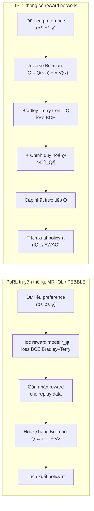

Ý tưởng cốt lõi: với một policy cố định, **toán tử Bellman ngược**
`(T* Q)(s,a) = Q(s,a) − γ E_{s'}[V(s')]` cho phép biểu diễn hàm thưởng hoàn toàn thông qua Q.
Do đó ta có thể thay `r` trong mô hình Bradley–Terry bằng `Q − γV` và tối ưu **trực tiếp Q** từ preference,
bỏ hẳn bước học reward model và giảm số tham số.

### 1.3. Hàm mục tiêu tổng quát

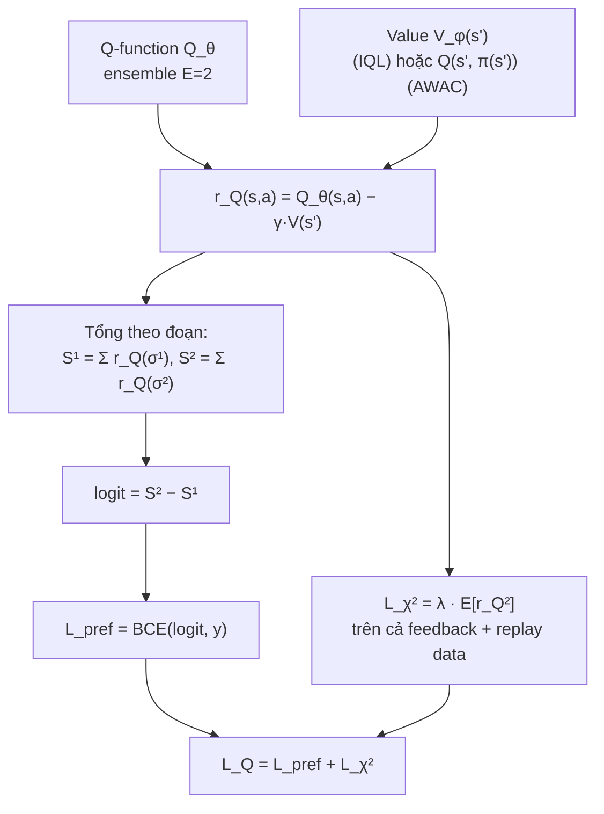

Vai trò của chính quy hoá χ² (`chi2_coeff = λ`): giữ cho reward ngầm định `r_Q` bị chặn,
tránh Q trôi tự do vì preference chỉ xác định reward đến một hằng số. Khi bật `target_clipping`,
`V(s')` được kẹp trong `[−1/(λ(1−γ)), 1/(λ(1−γ))]` cho phù hợp với miền giá trị mà χ² ngụ ý.

---

## 2. Thuật toán ứng dụng

### 2.1. Cấu trúc mạng (`ActorCriticValuePolicy`)

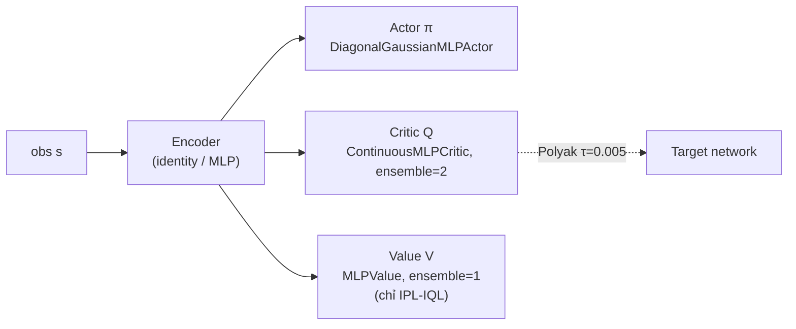

Ba optimizer Adam riêng biệt: `actor`, `critic` (gồm cả encoder), `value`.

### 2.2. IPL-IQL — một bước `train_step`

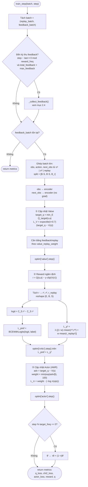

### 2.3. IPL-AWAC — khác biệt so với IPL-IQL

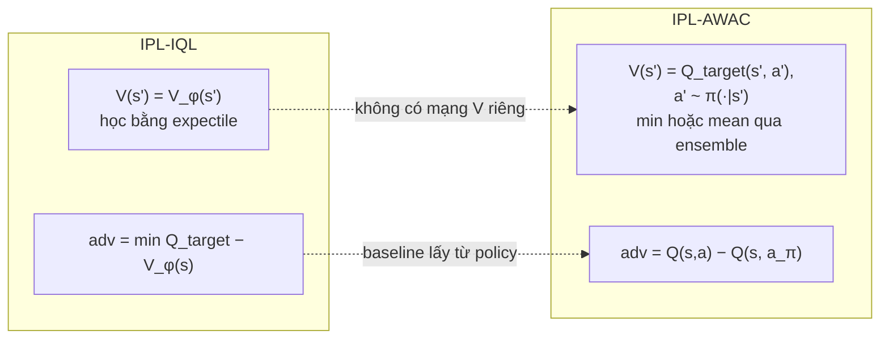

Phần còn lại (BCE preference + χ², actor dạng advantage-weighted regression, Polyak target) giống hệt.

### 2.4. Thu thập feedback online (khi `max_feedback > 0`)

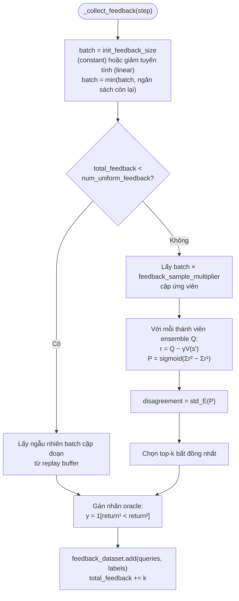

### 2.5. Baseline Preference-IQL (MR-IQL / Oracle-IQL) để đối chiếu

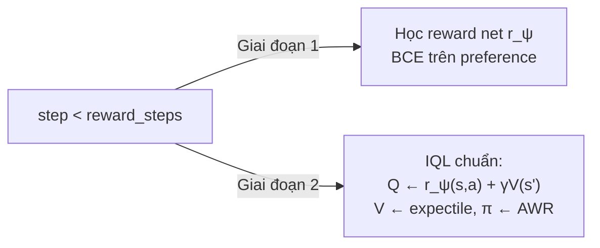

---

## 3. Quá trình huấn luyện

### 3.1. Từ dòng lệnh đến vòng lặp

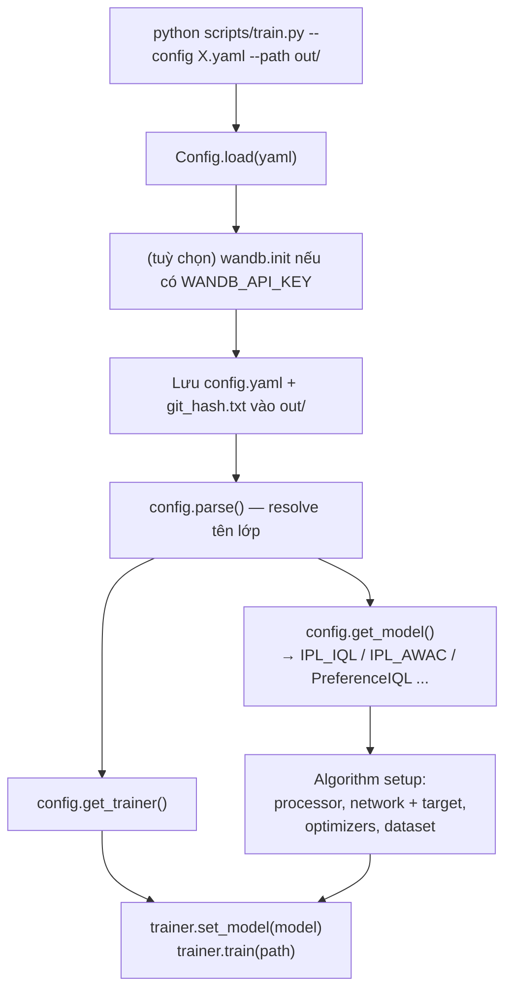

Sweep `.json` (ví dụ `configs/gym_locomotion/locomotion.json`) chạy nhiều config/seed qua `tools/run_local.py` hoặc `tools/run_slurm.py`.

### 3.2. Pipeline dữ liệu (`ReplayAndFeedbackBuffer`)

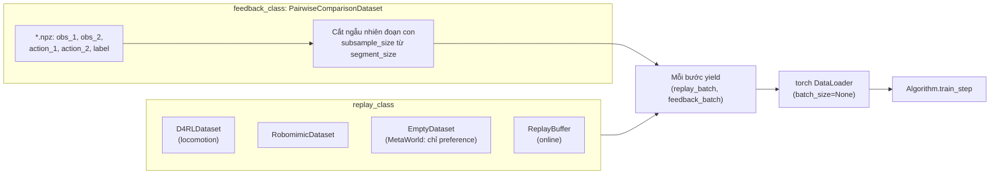

### 3.3. Vòng lặp `Trainer.train`

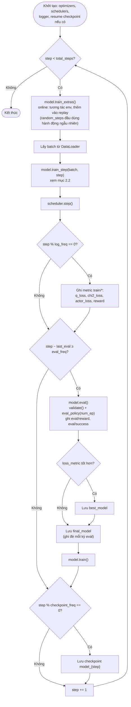

### 3.4. Siêu tham số chính theo benchmark

| Tham số | Gym locomotion (`configs/gym_locomotion/ipl_iql.yaml`) | MetaWorld (`configs/metaworld/ipl_iql.yaml`) |
|---|---|---|
| `chi2_coeff` λ | 0.5 | 3 |
| `expectile` | 0.7 | 0.75 |
| `beta` (nhiệt độ AWR) | 1/3 | 1/3 |
| `target_clipping` | True | False |
| `*_replay_weight` | 0.5 | 0.5 |
| Hidden layers | [256, 256] | [256, 256, 256] |
| Replay data | D4RL (batch 256) | không có (`EmptyDataset`) |
| Feedback batch / segment / subsample | 8 / 100 / 64 | 16 / 25 / 16 |
| `total_steps` | 1 000 000 | 200 000 |
| `eval_freq` / số episode | 5000 / 10 | 2500 / 20 |
| Optimizer | Adam, lr 3e-4 | Adam, lr 3e-4 |

---

## 4. Tóm tắt toàn trình

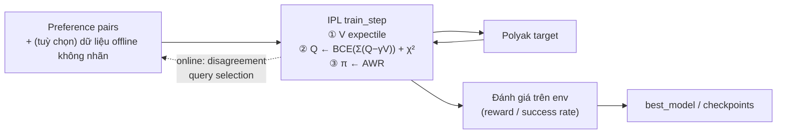
